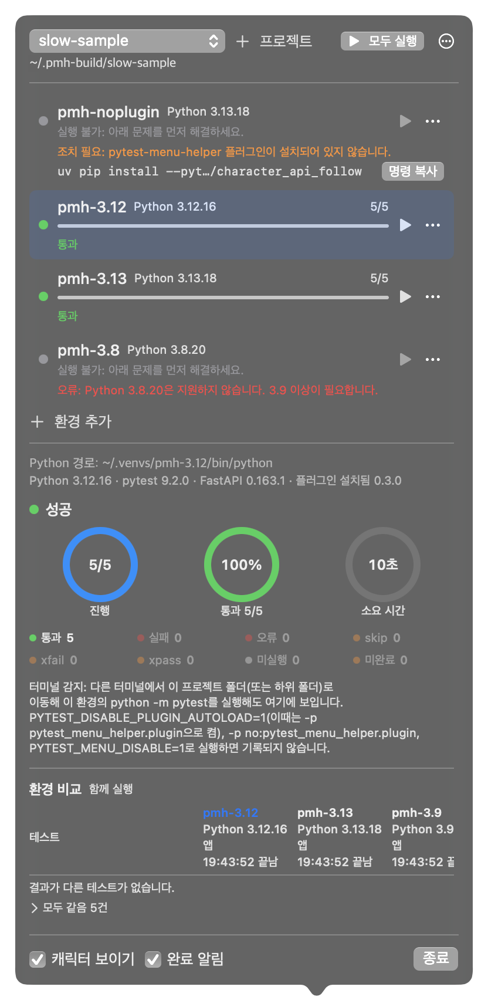

# pytest Menu Helper

**FastAPI 프로젝트의 pytest 실행 상황과 결과를 macOS 메뉴 막대와 여우 캐릭터로 보여 주는 테스트 보조 도구입니다.**

테스트가 끝났는지 보려고 터미널을 계속 들여다보지 않아도 되게 하고, 실패한 테스트와 원인을 빨리 찾게 하는 것이 목적입니다. 기말 과제용 미니프로젝트이며, 구현 계획 13단계 중 **1~9단계를 구현**했습니다.

<p align="center">
  
  &nbsp;&nbsp;
  
</p>

## 무엇을 하나요

- **앱에서 pytest 실행·중지:** 메뉴 막대의 여우 아이콘을 누르면 팝오버가 열립니다. 프로젝트와 Python 가상환경을 등록하고 환경마다 ▶·■로 실행하고 멈춥니다.
- **결과와 실패 원인:** 환경별 진행 바, 진행·통과율·소요 시간 링, 상태별 건수(통과·실패·오류·skip·xfail·xpass·미실행·미완료), 실패한 테스트의 파일·줄 번호·오류 메시지와 traceback을 보여 줍니다.
- **여러 가상환경 동시 실행과 비교:** [모두 실행]으로 등록한 환경을 한꺼번에 돌립니다(앱 전체 최대 10개, 넘치면 차례 기다림). "환경 비교" 절에서 환경마다 결과가 다른 테스트를 먼저 보여 줍니다.
- **다른 터미널의 pytest도 감지:** 플러그인을 설치한 환경이면 터미널에서 돌린 pytest도 같은 환경 행에 "터미널"로 보입니다.
- **캐릭터:** 화면 구석의 여우가 실행 중에는 달리고, 모두 통과면 점프하고, 실패가 있으면 넘어집니다.
- **완료 알림:** 실행이 끝나면 알림 1건을 보냅니다. 여러 환경을 함께 돌렸으면 다 끝난 뒤 요약 1건입니다. 누르면 그 결과로 팝오버가 열립니다.

## 화면 둘러보기

**팝오버**(위 왼쪽 그림, 위에서 아래로)

1. **머리:** 프로젝트 고르기, [+ 프로젝트], [모두 실행]과 실행 중에 그 자리에 나오는 [모두 중지], "⋯" 메뉴.
2. **환경 행:** 이름과 Python 버전, 진행 바와 상태 글씨, ▶·■. 준비가 안 된 환경은 "실행 불가"와 이유, 필요하면 설치 명령과 [명령 복사]가 보입니다.
3. **상세:** 고른 환경의 Python 경로와 pytest·플러그인 버전, 진행·통과율·소요 시간 링, 상태별 건수, 실패한 테스트 목록(눌러서 traceback 펼침).
4. **환경 비교:** 결과가 있는 환경이 2개 이상이면 보입니다. 결과가 다른 테스트가 위에, 모두 같은 테스트는 "모두 같음 N건"으로 접힙니다. 환경이 많으면 좌우로 스크롤합니다.
5. **아래:** [캐릭터 보이기], [완료 알림], [종료].

**캐릭터 포즈**

| 실행 중 | 통과 | 실패 | 확인 필요(중단·미완료 등) |
|:---:|:---:|:---:|:---:|
|  |  |  |  |

포즈 아래에 팝오버 행과 같은 상태 글씨("실행 중 3/5", "1/2 환경 실패" 등)가 붙습니다. 캐릭터를 누르면 팝오버가 열립니다.

## 결과 판정 규칙

성공·실패는 **pytest의 테스트 판정**이 기준입니다. API가 정상 응답해도 테스트의 검증 조건을 만족하지 않으면 실패입니다.

- 실패·오류가 있는 정상 종료는 미실행이 남아도 **"실패"**입니다.
- 일부 단계만 기록됐거나 외부에서 `kill -9`로 끝나면 **"미완료"**, Ctrl+C나 ■로 멈추면 **"중단됨"**입니다. 이런 실행은 전체 성공으로 보지 않습니다.
- skip·예상 실패·테스트 없음은 전체 성공과 구분해 표시합니다.
- **여러 환경을 함께 돌린 묶음:** 모두 통과면 "N개 환경 통과"(점프), 하나라도 실패면 "F/N 환경 실패"(넘어짐), 실패는 없지만 중단·실행 오류 같은 확인 필요 결과가 섞이면 "N개 환경 중 P개 통과"(갸웃)입니다. 준비가 안 된 환경(플러그인 없음 등)은 [모두 실행]에서 건너뛰어 묶음에 들어가지 않습니다.

## 설치

시스템 Python을 바꾸지 않도록 [uv](https://docs.astral.sh/uv/)로 저장소 밖 `~/.venvs/`에 가상환경을 만듭니다. 저장소 루트에서 실행합니다.

```sh
uv venv --python 3.13 ~/.venvs/pmh-3.13
uv pip install --python ~/.venvs/pmh-3.13/bin/python -e '.[dev]'   # 플러그인 + pytest·FastAPI·httpx
~/.venvs/pmh-3.13/bin/python -m pytest                                # 수집기·집계기 테스트

app/build.sh                              # ~/.pmh-build/PytestMenuHelper.app (ad-hoc 서명)
open ~/.pmh-build/PytestMenuHelper.app    # 알림 조건 때문에 open으로 실행
app/test.sh                               # Swift 테스트
```

플러그인만 설치하려면 `uv pip install --python <환경>/bin/python -e .`입니다. 설치하면 `pytest11` entry point로 그 환경의 모든 pytest 실행을 `~/Library/Application Support/pytest-menu-helper/events/`에 기록합니다(`PYTEST_MENU_DISABLE=1`로 끔).

**첫 실행 때 알림을 허용합니다.** 권한 창이 뜨면 [허용]을 누릅니다. 창이 안 보이고 팝오버 맨 아래에 "알림이 꺼져 있습니다…"가 보이면 [설정 열기]로 시스템 설정 > 알림 > pytest Menu Helper에서 허용합니다.

앱 다시 시작: `pkill -x PMHApp; sleep 1.5; open ~/.pmh-build/PytestMenuHelper.app`. 종료는 팝오버 맨 아래 [종료] 또는 메뉴 막대 아이콘 오른쪽 클릭의 "종료"입니다.

**주의: 앱에서 실행한 pytest는 셸 설정을 받지 않습니다.** `open`으로 띄운 앱은 `.zshrc` 등의 환경변수와 PATH를 받지 않고 가상환경도 활성화하지 않습니다. 환경변수나 외부 명령에 기대는 테스트는 앱에서만 실패할 수 있습니다.

## 등록

1. 메뉴 막대의 여우 아이콘을 왼쪽 클릭해 팝오버를 엽니다.
2. [+ 프로젝트]로 `examples/slow_demo`를 고릅니다. 이어서 열리는 "환경 추가" 폼에서 `~/.venvs/pmh-3.13/bin/python`을 고르고 [추가]를 누릅니다.
3. 같은 방법으로 `examples/fastapi_demo`를 등록합니다. 여러 환경 비교를 보려면 `examples/multi_env_demo`에 Python 3.9 환경과 3.13 환경을 함께 추가합니다.
4. 환경 행이 "실행 전"이고 ▶가 켜져 있으면 준비 끝입니다. "조치 필요"면 [명령 복사]로 설치 명령을 복사해 터미널에서 실행한 뒤 "⋯ > 이 환경 다시 검사"를 누릅니다.

프로젝트 폴더를 옮기거나 이름을 바꾸면 "프로젝트 폴더가 없습니다"와 [폴더 다시 지정]이 보입니다. 새 폴더를 고르면 등록한 환경은 그대로 두고 경로만 바뀝니다.

## 데모 대본(약 4분)

샘플: `examples/slow_demo`(5개, 약 10초, 모두 통과), `examples/fastapi_demo`(통과 1·의도된 실패 1), `examples/multi_env_demo`(Python 3.9에서만 1건 실패, 약 6초). 위 "등록"을 마친 상태에서 시작합니다.

1. **성공:** slow_demo의 pmh-3.13 ▶. 행이 "실행 중 n/5"가 되고 캐릭터가 달립니다. 끝나면 "통과", 캐릭터가 점프하고 알림 "통과 · slow_demo / pmh-3.13"이 뜹니다.
2. **실패:** fastapi_demo로 바꿔 ▶. "실패 1", 캐릭터가 넘어지고 알림 둘째 줄에 실패 위치가 보입니다. 알림을 누르면 그 환경으로 팝오버가 열리고, "실패한 테스트"에서 traceback을 펼칩니다.
3. **중단:** slow_demo ▶ 뒤 2~3초에 ■. "중단됨", 캐릭터가 갸웃합니다. **직접 멈춘 실행이라 알림은 없습니다.**
4. **여러 환경 비교:** multi_env_demo에서 [모두 실행]. 캐릭터가 "2개 환경 실행 중"으로 달리다 "1/2 환경 실패"로 넘어지고, 요약 알림 1건 "2개 환경 중 1개 실패"가 옵니다. 상세 아래 "환경 비교"에서 `test_zip_strict_rejects_uneven_lengths`가 3.9 실패, 3.13 통과로 맨 위에 보입니다.
5. **터미널 실행:** Terminal.app에서 `cd examples/slow_demo && ~/.venvs/pmh-3.13/bin/python -m pytest`. 행이 "터미널 실행 중 n/5"(■ 없음)가 되고 끝나면 "통과 · 터미널"과 알림이 뜹니다.

## 지원 범위와 제한

- **macOS 13 이상**(이 Mac에서만 확인. ad-hoc 서명이라 다른 Mac 배포·공증은 하지 않았습니다).
- **Python 3.9 이상, pytest 8.4 이상.** FastAPI 샘플을 돌리려면 그 환경에 FastAPI·httpx가 필요합니다.
- **플러그인을 설치한 환경만** 결과를 볼 수 있습니다. 없는 환경은 "조치 필요"와 설치 명령을 보이고 ▶를 끕니다.
- 앱 실행은 **한 환경에 1개, 앱 전체 10개까지** 동시에 돕니다(터미널 실행은 따로 셉니다). 동시에 돌리면 프로젝트의 `.pytest_cache`를 같이 써서 `--lf`(직전 실패만 다시) 목록은 마지막에 끝난 환경 것이 남습니다.
- 결과는 **메모리에만** 있어 앱을 다시 켜면 사라집니다(보존은 11단계). 앱을 켜기 전에 끝난 터미널 실행은 보이지 않습니다.
- 알림은 Bundle ID가 있는 .app을 **`open`으로 실행**해야 뜹니다. 집중 모드(방해 금지)에서는 화면에 뜨지 않습니다. 권한이 없어도 팝오버와 캐릭터로 결과를 볼 수 있습니다.
- `-k` 등으로 고른 테스트가 통과한 것은 그 선택 범위의 성공입니다. 환경 비교는 실행 인수가 다르면 경고를 보입니다.

## 구현 상태

| 단계 | 내용 | 상태 |
|---|---|---|
| 1~2 | pytest 플러그인(0.3.0)이 실행마다 JSONL 이벤트를 남기고, 집계기가 테스트·실행 상태를 판정 | 완료 |
| 3~4 | 메뉴 막대 앱: 프로젝트·환경 등록, 환경 검사와 조치 안내, 앱에서 pytest 실행·중지 | 완료 |
| 5 | 결과 팝오버: 환경별 행, 진행 바와 링, 건수, 실패 목록과 traceback | 완료 |
| 6 | 다른 터미널의 pytest 실행 감지 | 완료 |
| 7 | 상태에 따라 움직이는 여우 캐릭터 | 완료 |
| 8 | 완료 알림과 권한 안내, 프로젝트 폴더 없음 처리, 데모 샘플 | 구현 완료, 화면 일부 확인 대기(알림 거부 안내·토글·폴더 다시 지정) |
| 9 | 여러 가상환경 동시 실행, 환경 비교, 묶음 단위 캐릭터와 요약 알림 | 완료 |
| 10 | 실패 위치를 에디터에서 열기 | 예정 |
| 11 | 실행 이력과 새 실패·회복 표시(같은 환경의 시간에 따른 변화) | 예정 |
| 12~13 | 프로젝트 파일·테스트 맵, 실제 함수 호출 경로를 추적해 캐릭터로 재생 | 예정 |

**검증(2026-11-18):** Python 테스트 52개가 3.9.6(pytest 8.4.2), 3.12.16·3.13.18(pytest 9.2.0)에서 각각 통과, Swift 테스트 213개 통과. 실제 Python 3.9와 3.13 환경을 동시에 돌려 3.9만 실패하는 것을 재현했고, 1·3·10개 동시 실행에서 환경별 소요 시간이 같았습니다(약 9.9초). 화면 동작은 단계마다 사용자가 직접 확인합니다(`docs/APP.md`의 단계별 확인 목록).

12~13단계의 호출 경로 추적은 스레드·비동기 처리에서의 정확성, 성능 영향, 기록 누락을 따로 검증해야 합니다. 별도 프로세스로 띄운 API 서버의 내부 경로는 pytest 프로세스만 추적해서는 알 수 없습니다.

## 개발용: 수집과 집계만 확인하기

```sh
mkdir -p .menu-events
python -m pytest -p pytest_menu_helper.plugin \
  --menu-events .menu-events/demo.jsonl examples/fastapi_demo
python -m pytest_menu_helper.aggregate .menu-events/demo.jsonl
```

**성공 1건·실패 1건, 종료 코드 1이 이 샘플의 예상 결과입니다.** 플러그인을 설치한 환경이면 `-p`와 `--menu-events` 없이도 자동으로 기록합니다. 화면 없이 앱의 실행 로직을 돌려 보는 `pmh-run`은 `docs/APP.md`의 "개발용 통합 검증" 절에 있습니다.

## 구성과 문서

- 대상: macOS, Python 3.9 이상, FastAPI 프로젝트와 pytest 8.4 이상
- 결과 수집·집계: Python pytest 플러그인(`src/pytest_menu_helper/`)
- macOS 앱: Swift, AppKit·SwiftUI(`app/`, SwiftPM, Xcode 프로젝트 없이 Command Line Tools로 빌드)

| 문서 | 내용 |
|---|---|
| [구현 순서](IMPLEMENTATION_PLAN.md) | 13단계 계획과 단계별 완료 기준 |
| [메뉴 막대 앱](docs/APP.md) | 구조, 빌드, 실행 방식, 단계별 검증과 사용자 확인 목록, 알려진 제한 |
| [캐릭터](docs/CHARACTER.md) | 상태와 포즈 대응, 창 동작 |
| [이벤트 명세](docs/EVENTS.md) | JSONL 필드, 집계 규칙과 제한 |
| [8단계 설계](docs/STEP8_DESIGN.md), [9단계 설계](docs/STEP9_DESIGN.md) | 알림·견고성, 여러 환경 동시 실행의 결정과 위험 |
| [알림용 앱 번들](docs/NOTIFICATION_BUNDLE.md) | 알림이 표시되는 빌드·실행 조건 |
| [구현 가능성 검토](docs/FEASIBILITY.md) | 실험 근거와 아직 검증하지 않은 범위 |
| [multi_env_demo](examples/multi_env_demo/README.md) | 환경별로 결과가 갈리는 샘플과 공유 자원 충돌 예 |
